<div align="center">

<picture>
  <source media="(prefers-color-scheme: dark)" srcset="docs/imagens/logo-escuro.svg">
  
</picture>

**Acompanhe e comande, pelo celular, seus agentes de código: Claude Code, Codex, Gemini CLI, OpenCode e Cline.**

[](https://github.com/victor-kauan-coder/duckv/releases/latest)


[](https://github.com/victor-kauan-coder/duckv/actions/workflows/ci.yml)


[Começar](#começar-em-3-passos) · [Telas](#telas) · [Como funciona](#como-funciona) · [Segurança](#segurança) · [Problemas comuns](#problemas-comuns)

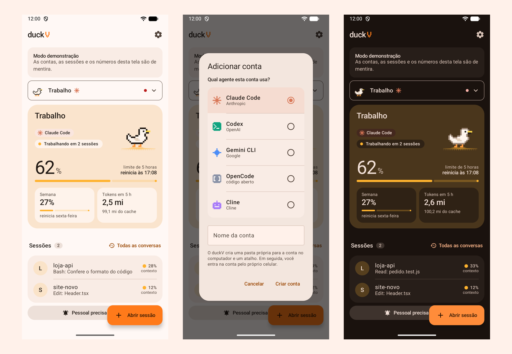

</div>

---

O **duckV** junta num app só os agentes de código que rodam no seu computador, com quantas contas você quiser de cada um: [Claude Code](https://claude.com/claude-code), [Codex](https://github.com/openai/codex), [Gemini CLI](https://github.com/google-gemini/gemini-cli), [OpenCode](https://opencode.ai) e [Cline](https://cline.bot). Do celular você vê o que cada sessão está fazendo, quanto do limite já gastou, responde pedidos de permissão, conversa, anexa arquivos e abre sessões novas no computador, sem trocar de login e sem estar na frente da máquina.

> [!NOTE]
> Ferramenta pessoal e **não oficial**, sem ligação com Anthropic, OpenAI, Google, OpenCode ou Cline. Os nomes dos agentes são marcas dos seus donos; os ícones em pixels do app são desenhos próprios.

## Sumário

- [Destaques](#destaques)
- [Agentes](#agentes)
- [Começar em 3 passos](#começar-em-3-passos)
- [No computador: app ou terminal](#no-computador-app-ou-terminal)
- [No navegador: Mac, iPhone e outros computadores](#no-navegador-mac-iphone-e-outros-computadores)
- [O que você precisa](#o-que-você-precisa)
- [Telas](#telas)
- [Uso no dia a dia](#uso-no-dia-a-dia)
- [Contas](#contas)
- [Como funciona](#como-funciona)
- [Segurança](#segurança)
- [Acesso de qualquer lugar](#acesso-de-qualquer-lugar)
- [Depois de reiniciar o computador](#depois-de-reiniciar-o-computador)
- [Opções](#opções)
- [O pato](#o-pato)
- [O que os números significam](#o-que-os-números-significam)
- [Limites conhecidos](#limites-conhecidos)
- [Problemas comuns](#problemas-comuns)
- [Para desenvolvedores](#para-desenvolvedores)
- [Desinstalar](#desinstalar)

## Destaques

| | |
|---|---|
| **Vários agentes, várias contas** | Claude Code, Codex, Gemini CLI, OpenCode e Cline lado a lado. Cada conta mostra o ícone e o nome do agente, em todas as telas. |
| **Todas as contas num lugar** | Uma tela por conta, com o limite de 5 horas e o da semana em tempo real (Claude Code e Codex). |
| **Conversa completa** | Mensagens, tabelas, blocos de código, imagens, lista de tarefas e as ferramentas que o agente usa. |
| **Contexto à vista** | Um anel ao lado da caixa de mensagem mostra quanto da memória da conversa já foi usado, com o detalhe a um toque. |
| **Permissões no bolso** | Aceite, recuse ou recuse dizendo o que fazer no lugar. Direto na notificação, mesmo com o app fechado. |
| **Abrir sessões pelo celular** | Escolha conta, pasta, modelo, esforço e modo de permissão; a sessão roda no computador e você comanda pelo app. |
| **Conversas do Claude desktop** | Todas as conversas de cada conta, inclusive as feitas no app Claude desktop, para acompanhar ou continuar. |
| **Anexos** | Mande arquivos do celular para o agente ler. |
| **Mensagens de voz** | Toque no microfone e fale: o celular transcreve ao vivo, você revisa ou envia direto, e a mensagem aparece com o selo de voz. |
| **Arquivos do computador** | Peça ao agente "manda esse arquivo para o meu celular" (ou rode `node tools\enviar.mjs arquivo`): ele aparece no app, com aviso, para baixar em Downloads/duckV, abrir ou compartilhar. |
| **Comandos e skills ao digitar /** | Digite `/` na conversa e aparecem os comandos do agente e as skills e comandos personalizados do computador, com descrição; tocar completa o nome. |
| **Responder pela notificação** | Quando uma sessão termina, responda direto na notificação, como no WhatsApp, sem abrir o app. |
| **Atualização pelo app** | Quando sai uma versão nova, o computador a traz do GitHub (pelas Releases deste repositório), confere o SHA-256 e o app mostra o que mudou e instala com um toque. Também em Opções > Procurar atualização. |
| **Pareamento verificado** | O QR sozinho não dá acesso: os 4 números do celular precisam ser digitados no computador. |
| **Instalação em um clique** | O instalador cuida do que faltar e faz o login das contas. |
| **Um pato por conta** | Ele mostra, em pixels, se a conta trabalha, espera, dorme ou precisa de você. |

## Agentes

Cada conta do duckV usa um agente. Você escolhe o agente ao adicionar a conta, e o app mostra o ícone dele no seletor de contas, no cartão da conta, na tela de abrir sessão e no topo de cada conversa.

<div align="center">
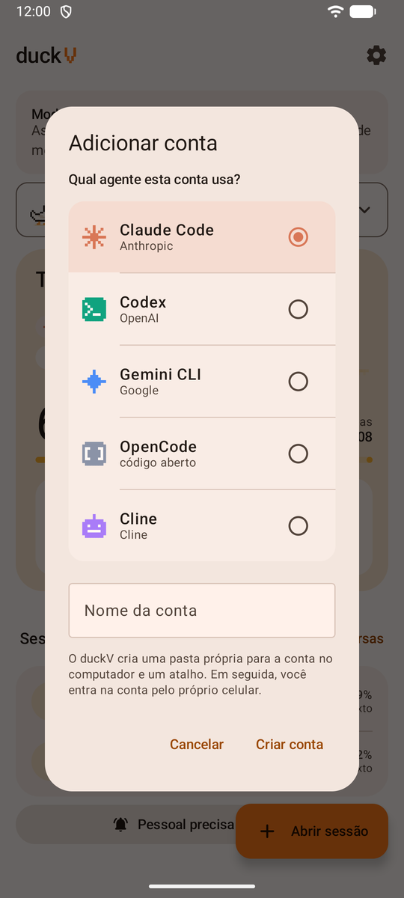
</div>

| | Claude Code | Codex | Gemini CLI | OpenCode | Cline |
|---|:---:|:---:|:---:|:---:|:---:|
| Abrir sessão pelo celular | ✓ | ✓ | ✓ | ✓ | ✓ |
| Conversa e tokens no app | ✓ | ✓ | ✓ | ✓ ¹ | ✓ |
| Perguntas e permissões como botões | ✓ | ✓ | ✓ | pela tela do terminal | ✓ |
| Entrar na conta pelo celular | ✓ | ✓ | ✓ | ✓ | ✓ |
| Limite de 5 horas e da semana | ✓ | ✓ | — | — | — |
| Conversas antigas e continuar | ✓ | ✓ | ✓ | ✓ | ✓ |
| Sessão aberta no computador, ao vivo | ✓ ² | — | — | — | — |

¹ Precisa do Node.js 22.13 ou mais novo no computador (o OpenCode guarda as conversas num banco SQLite).
² Pelo canal do Claude Code. Nos outros agentes, as sessões abertas no computador aparecem depois em **Todas as conversas**, e dá para continuá-las pelo celular.

**Como entrar em cada agente pelo celular:** toque em **Entrar nesta conta**. O Claude Code abre a página da Anthropic e pede o código que ela mostra no fim. Os outros abrem a própria tela de login do agente: os links viram botões que abrem no navegador do celular, os menus viram botões e há um campo para colar códigos. O Codex mostra um código de dispositivo; o Gemini CLI, um link do Google e um campo para o código; o OpenCode e o Cline, a lista de provedores (o OpenCode funciona até sem login, com os modelos gratuitos dele).

**O que o duckV garante em cada agente**, sempre, nas sessões abertas pelo celular:

| Agente | Regra aplicada |
|---|---|
| Claude Code | Sem o modo que pula todas as permissões. |
| Codex | Sempre pede aprovação (`-a on-request`) e roda em sandbox: edita só a pasta do projeto ou só lê. Nunca o modo sem sandbox. |
| Gemini CLI | Sem o modo `yolo`: pergunta sempre, aceita só edições ou só planeja. |
| OpenCode | Tudo pede permissão, exceto ler; nada fora da pasta do projeto; compartilhar conversas na internet desligado. |
| Cline | A aprovação automática, que vem ligada por padrão no Cline, é sempre desligada. |

Os comandos de barra que mudam permissões (`/permissions`, `/approvals`, `/yolo`, `/share`…) e os comandos com `!` não passam pelo celular; cada agente tem a sua lista de comandos liberados. Skills e comandos personalizados instalados no computador também passam, menos os que liberam o terminal sozinhos (`allowed-tools` com Bash ou `` !`comando` `` no texto): esses aparecem na lista, marcados, e só rodam no computador.

## Começar em 3 passos

**1. No computador.** Baixe esta pasta (botão **Code › Download ZIP**, ou `git clone`) e rode o instalador do seu sistema, respondendo as perguntas com S ou N:

| Sistema | Como instalar |
|---|---|
| Windows 10 ou 11 | Dois cliques em **`instalar.cmd`** |
| Linux | No terminal, dentro da pasta: `sh instalar.sh` |
| macOS | No Terminal, dentro da pasta: `sh instalar.sh` |

O instalador:

- instala o que faltar: Claude Code e, se você quiser, o Tailscale (no Windows, também o Node.js; no Linux e no macOS ele explica como instalar o Node.js, se faltar);
- prepara uma pasta separada para cada conta e liga cada uma ao duckV;
- abre o navegador para você entrar em cada conta Claude;
- cria o atalho **duckV** (área de trabalho no Windows; menu de aplicativos e área de trabalho no Linux; `duckV.command` na Mesa do macOS) e, se você quiser, faz ele ligar junto com o computador;
- liga o duckV.

**2. No celular (Android).** Instale o **`duckV.apk`** da [página de versões](https://github.com/victor-kauan-coder/duckv/releases/latest) (o Android pede para permitir "instalar apps desconhecidos"). Para usar fora de casa, instale também o app **Tailscale** e entre com a mesma conta do computador. No duckV, toque em **Escanear código** e aponte para o código da janela do duckV.

**3. Confirme no computador.** O celular mostra 4 números. Digite-os na janela do duckV e aperte Enter. Pronto.

<div align="center">
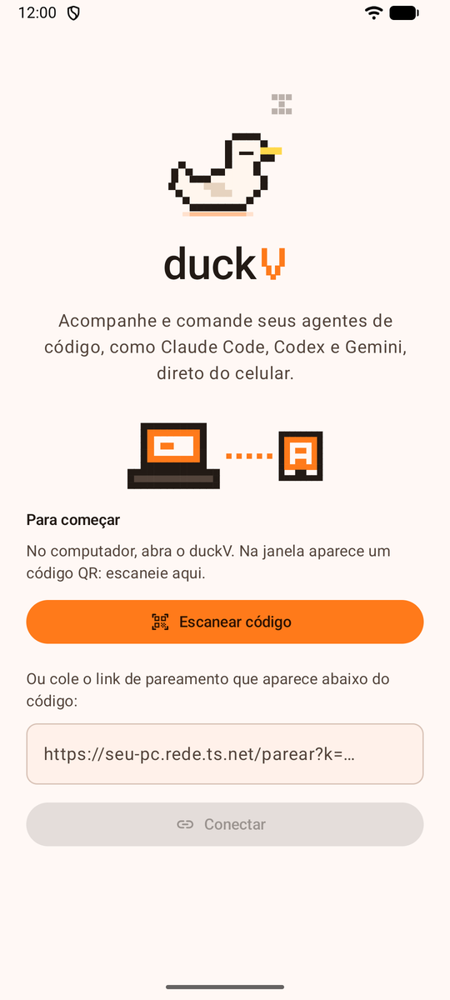
&nbsp;&nbsp;
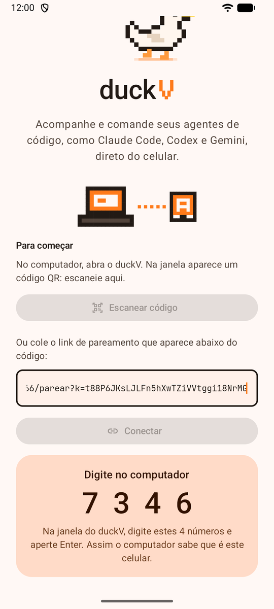
</div>

> [!TIP]
> Pulou o login de alguma conta? Entre depois pelo próprio celular: o cartão da conta mostra **Entrar nesta conta**.

## No computador: app ou terminal

O duckV também tem uma janela própria para o computador (Windows e Linux), para comandar todas as contas e sessões sem a janela preta do terminal. No Mac (e em qualquer outro computador), a mesma tela abre no navegador: veja [No navegador](#no-navegador-mac-iphone-e-outros-computadores). O terminal continua funcionando do mesmo jeito: use o que preferir.

<div align="center">
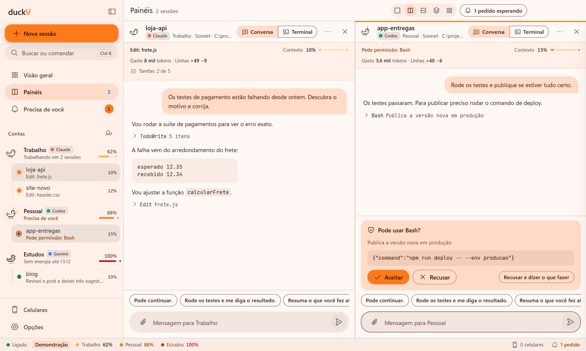
</div>

| | App (janela própria) | Terminal |
|---|---|---|
| Como abrir | Atalho **duckV App**, ou `abrir-app.cmd` / `./abrir-app.sh` | Atalho **duckV**, ou `iniciar-duckv.cmd` / `./iniciar-duckv.sh` |
| Conectar celular | QR na tela **Celulares**; os 4 números são digitados na janela | QR na janela do terminal; os 4 números são digitados nela |
| Abrir uma conta | **Nova sessão** (escolha "Aqui no duckV" ou "Terminal do sistema") | Atalho da conta: `conta1.cmd`, `conta2.sh`… |

O que o app faz:

- **Todas as contas na lateral**, cada uma com o pato, o agente, o limite de 5 horas e as sessões abertas. Clique numa sessão para abrir; **Ctrl+clique** abre ao lado; também dá para arrastar uma sessão até um painel.
- **Painéis lado a lado**: um, dois, três ou quatro (Ctrl+1 a Ctrl+5). Cada painel mostra a **Conversa** (mensagens, pedidos, mensagens rápidas, `/` com os comandos e anexos arrastados) ou o **Terminal** de verdade da sessão, com cores, para digitar como no teclado.
- **Precisa de você** (Ctrl+J): os pedidos de permissão e as perguntas de todas as contas numa fila só, do mais antigo para o mais novo; **A** aceita e **R** recusa o primeiro.
- **Aviso no canto da tela**: com a janela fora de foco ou fechada na bandeja, o pedido aparece num cartão por cima das outras janelas, com **Aceitar**, **Recusar** e **Abrir**. Ele não rouba o foco de quem está digitando.
- **Conta automática**: em Nova sessão, "Automática" escolhe a conta com mais limite livre.
- **Busca rápida** (Ctrl+K): sessões, terminais, contas e comandos.
- **Barra de status** com o uso de cada conta; um clique mostra os limites e os horários de reinício.
- Fechar a janela deixa o duckV ligado na **bandeja**, perto do relógio; para desligar, use **Sair** no menu dela.
- **Controles próprios, no tema do duckV**: menus suspensos, interruptores, confirmações e dicas ao parar o mouse são desenhados pelo app (nada do visual cinza padrão do navegador), com o mesmo teclado dos controles do sistema: setas, Enter, Esc e digitar o começo de uma opção para pular até ela.
- **Movimento na troca de telas**: a tela nova surge com um leve deslize, painéis entram crescendo e saem encolhendo, diálogos sobem e descem. Com "reduzir movimento" ligado no sistema, a troca é direta.
- **Barra lateral recolhível**: o botão no topo dela (ou **Ctrl+B**) recolhe; com ela recolhida, o mesmo botão aparece no topo da área principal para trazer de volta.

<div align="center">
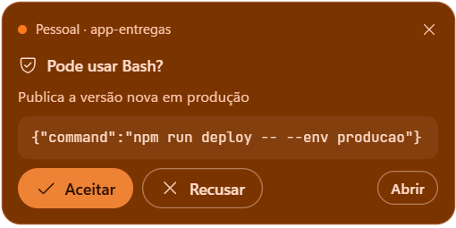
</div>

> [!NOTE]
> O app precisa do Node.js 22 ou mais novo no computador (o mesmo do duckV). Na primeira vez, ele baixa o Electron (cerca de 100 MB) para a pasta `desktop`. Se o duckV já estiver ligado num terminal, o app avisa e não derruba aquela janela: feche o terminal para usar o app, ou continue pelo terminal.

## No navegador: Mac, iPhone e outros computadores

O duckV também abre no navegador, sem instalar nada. Ele escolhe sozinho a tela certa: num computador (tela larga, com mouse ou trackpad) aparece a **mesma tela do app do computador**, com contas na lateral e painéis; num celular aparece a **versão para celular**. Dá para trocar a qualquer momento em **Opções › Versão da tela**.

| Onde | Como abrir |
|---|---|
| **iPhone** | No computador do duckV, abra **Celulares** e aponte o app **Câmera** do iPhone para o código. O link abre no Safari, que mostra 4 números: digite-os no computador. Depois, toque em **Compartilhar › Adicionar à Tela de Início** para ter o ícone do duckV. |
| **Mac com o duckV instalado nele** | Dois cliques em **duckV.command** (na Mesa) ou `./abrir-web.sh`. O duckV liga no Terminal e abre a tela dele no navegador; na primeira vez, digite no Terminal os 4 números que o navegador mostrar. |
| **Mac ou outro computador acessando o duckV de outra máquina** | No computador do duckV, abra **Celulares › Copiar link para um navegador** e abra o link no navegador do outro computador (pelo Tailscale). Ele mostra 4 números para digitar no computador do duckV. |
| **Windows ou Linux, no navegador em vez do app** | `abrir-web.cmd` (Windows) ou `./abrir-web.sh` (Linux). |

- **Como app**: no iPhone, "Adicionar à Tela de Início" abre o duckV em tela cheia, com ícone próprio; no Chrome e no Edge do computador, use **Instalar duckV** (no menu do navegador); no Safari do Mac, **Arquivo › Adicionar ao Dock**.
- **Avisos no iPhone**: o iOS só manda notificações de sites para um app **adicionado à Tela de Início** (iOS 16.4 ou mais novo) e aberto por **HTTPS** (ligue os certificados HTTPS no painel do Tailscale). Os botões Aceitar e Recusar na própria notificação existem só no app Android; no iPhone, o toque no aviso abre o pedido.
- **O que o navegador não faz**: o terminal de verdade das sessões, o pareamento de outros aparelhos e as janelas de terminal do sistema ficam só no app do computador (a chave dele nunca sai do computador).
- **Depois de parear**, abrir o link de novo leva direto para a tela do duckV, sem pedir os números outra vez. O código do link continua valendo para o próximo aparelho.

## O que você precisa

| Onde | O quê |
|---|---|
| Computador | Windows 10 ou 11, Linux (x64 ou ARM64, com glibc: Ubuntu, Debian, Fedora, Arch…) ou macOS (Intel ou Apple Silicon). Node.js 22 ou mais novo; no Windows o instalador usa o **winget**, que já vem no sistema. |
| Celular | Android 8 ou mais novo. |
| Contas | Uma ou mais contas de cada agente que for usar. O Claude Code e o Codex usam a assinatura (Pro, Max, Team ou Plus); o Gemini CLI, uma conta Google; o OpenCode funciona até sem conta. |
| Fora de casa | [Tailscale](https://tailscale.com/download) no computador e no celular, na mesma conta. Gratuito para uso pessoal. |

A instalação não mexe nos seus agentes de sempre: as contas do duckV vivem em pastas próprias dentro da sua pasta pessoal (`.claude-contas` para o Claude Code e `.duckv-contas` para os outros; no Windows, `C:\Users\voce\.claude-contas\`). Seus logins atuais, o app Claude desktop e as configurações de cada agente continuam como estão.

<details>
<summary><b>Instalação manual</b></summary>

1. Instale o [Node.js](https://nodejs.org) 22 ou mais novo e o Claude Code (`npm install -g @anthropic-ai/claude-code`, ou no Linux e no macOS `curl -fsSL https://claude.ai/install.sh | bash`).
2. Rode `npm install` e `node setup.mjs` (é o que `instalar.cmd` e `instalar.sh` fazem).
3. Entre em cada conta: `conta1.cmd` (Windows) ou `./conta1.sh` (Linux e macOS) e `/login`, ou `claude auth login` com `CLAUDE_CONFIG_DIR` apontando para a pasta da conta.
4. Abra `iniciar-duckv.cmd` ou `./iniciar-duckv.sh` (ou `npm start`).

No Linux, para o duckV se publicar no Tailscale sem `sudo`, rode uma vez `sudo tailscale set --operator=$USER`.

</details>

## Telas

<table>
<tr>
<td align="center" width="33%">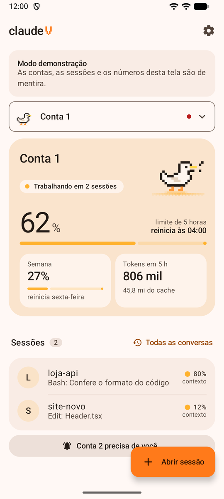<br><b>Início</b><br><sub>Limite de 5 horas em destaque, semana, tokens e as sessões da conta.</sub></td>
<td align="center" width="33%">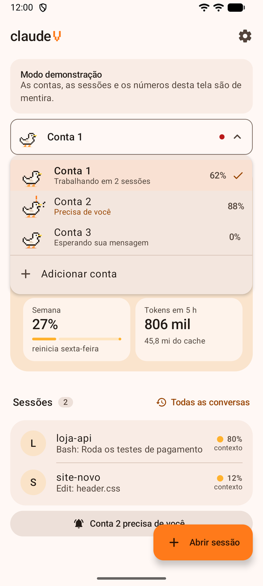<br><b>Contas e agentes</b><br><sub>Cada conta com o ícone do seu agente. O ponto vermelho avisa quem precisa de você.</sub></td>
<td align="center" width="33%">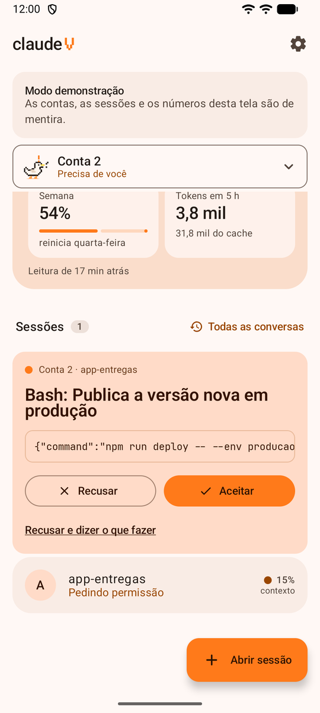<br><b>Permissões</b><br><sub>O comando inteiro, com aceitar, recusar ou recusar dizendo o que fazer.</sub></td>
</tr>
<tr>
<td align="center">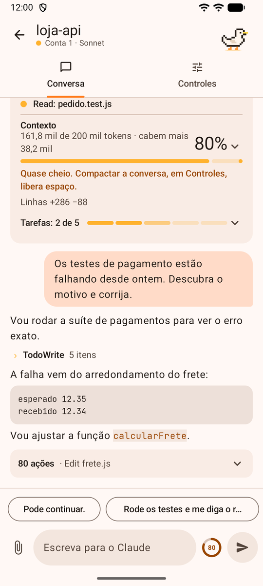<br><b>Conversa</b><br><sub>Contexto, tarefas, código, mensagens rápidas, anexos e o anel de contexto.</sub></td>
<td align="center">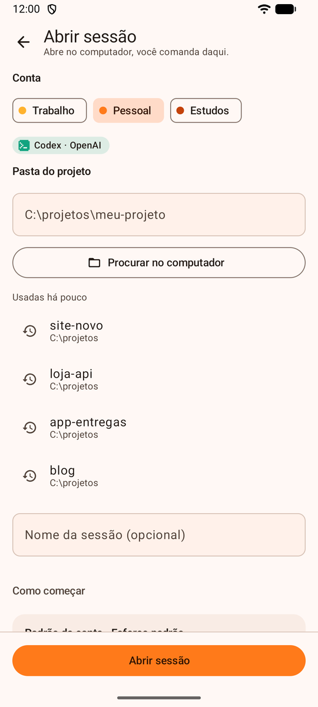<br><b>Abrir sessão</b><br><sub>Conta, o agente que vai abrir, pasta do projeto e nome.</sub></td>
<td align="center">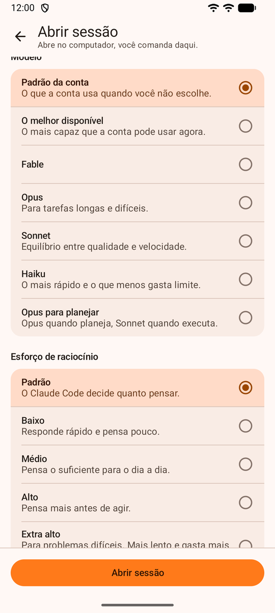<br><b>Modelo e esforço</b><br><sub>As opções de cada agente (aqui, o Codex).</sub></td>
</tr>
<tr>
<td align="center">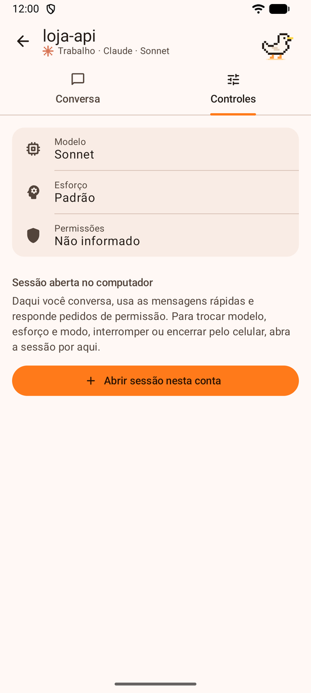<br><b>Controles</b><br><sub>Modelo, esforço, modo de permissão, interromper, compactar e encerrar.</sub></td>
<td align="center">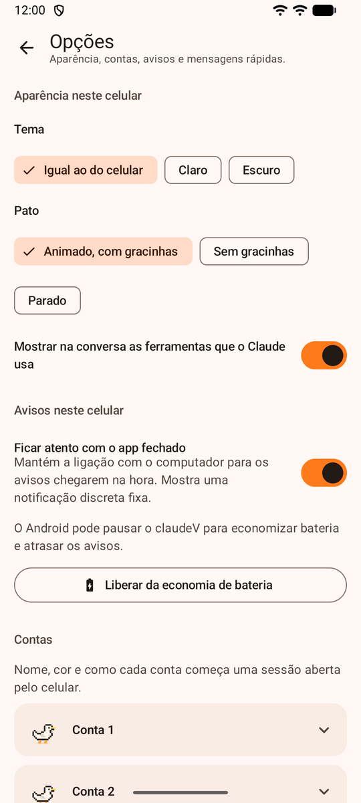<br><b>Opções</b><br><sub>Tema, pato, avisos, contas e mensagens rápidas.</sub></td>
<td align="center">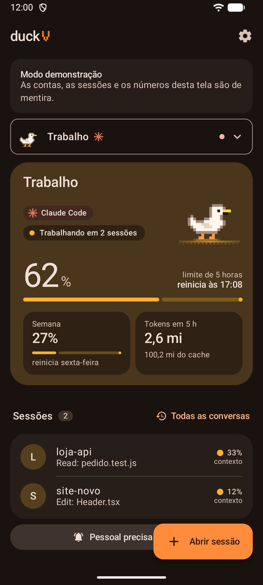<br><b>Tema escuro</b><br><sub>Segue o celular, ou escolha nas Opções.</sub></td>
</tr>
</table>

<sub>Capturas feitas no modo demonstração: contas, sessões e números de mentira.</sub>

## Uso no dia a dia

### Abrir uma sessão pelo celular

Toque em **Abrir sessão**, escolha a conta (o selo mostra qual agente vai abrir), a pasta do projeto, o modelo, o esforço e o modo de permissão. As opções são as do agente daquela conta. A sessão roda no computador, dentro do duckV, e você comanda tudo pelo app:

- **Conversa:** escreva, toque numa mensagem rápida ou anexe arquivos pelo clipe. Comandos também valem, como `/model opus` ou `/compact`.
- **Perguntas do agente** (incluindo "você confia nesta pasta?") aparecem como botões, e dá para escrever uma resposta própria quando a pergunta permite.
- **Controles:** interromper, compactar, limpar e encerrar. No Claude Code, também trocar modelo, esforço e modo no meio da sessão.
- **Tela do terminal:** a tela crua do agente, com setas, Enter, Esc, os links tocáveis e um campo para digitar. Serve para o que não virar botão.

### Abrir uma sessão no computador

Abra o atalho da conta (`conta1.cmd`, `conta2.cmd`…) e informe a pasta do projeto, ou arraste a pasta para cima do atalho. O atalho abre o agente da conta, com a pasta dela e as mesmas regras de segurança. No Claude Code aparece um aviso sobre "development channels": escolha **I am using this for local development**. O aviso aparece toda vez, porque o canal do duckV usa um recurso do Claude Code que ainda está em prévia.

Pelo celular você acompanha a sessão, conversa e responde permissões.

> [!WARNING]
> Organizações **Team** e **Enterprise** podem desligar esse canal. Nesse caso o Claude Code ignora as mensagens do celular, e o app avisa em até 30 segundos. Para conversar pelo celular com essas contas, abra a sessão **pelo celular**, que funciona em qualquer plano.

### Conversas antigas

Em **Todas as conversas** ficam todas as conversas de cada conta, com o título que o agente deu. Nas contas do Claude Code entram também as feitas no app **Claude desktop**, separadas pela conta de cada uma. Toque numa conversa para ler o histórico inteiro e continue de onde parou com **Continuar pelo celular**, sempre com o login da conta certa (feche a conversa no desktop antes, para as duas não escreverem juntas).

### Anexos e imagens

- **Colar um print**: no app do computador e no navegador, **Ctrl+V** (ou **⌘V**) com uma imagem copiada anexa a imagem. No app Android, quando há uma imagem copiada, aparece o botão **Colar imagem copiada** acima do campo (e a opção **Colar** no clipe).
- **Prévia antes de enviar**: cada anexo aparece como miniatura (imagem) ou etiqueta com nome e tamanho (outro arquivo) acima da caixa de mensagem, com um **X** para tirar. Prints colados ganham um nome com a hora, como `print-142305.png`.
- **Clipe e arrastar**: o clipe abre o seletor de arquivos (no celular: Câmera, Galeria/Fotos ou Arquivos); no computador, também dá para arrastar arquivos até a caixa. Até 10 por mensagem, 25 MB cada.
- **Na conversa**: o arquivo sobe para a pasta `data/anexos` do duckV no computador e o caminho vai no fim da mensagem, um por linha, para o agente ler. A conversa **não mostra o caminho**: mostra a miniatura (um clique amplia) ou um cartão para baixar o arquivo. Vale igual no computador, no navegador e no Android.
- Imagens que o agente abriu ou gerou também aparecem no chat e abrem em tela cheia.

### Pedidos de permissão

Aparecem no topo da conta e como notificação, com o comando inteiro e três saídas: **aceitar**, **recusar** ou **recusar dizendo ao agente o que fazer no lugar**. Nas sessões abertas no computador, o pedido aparece também na janela, e vale a primeira resposta.

**Na própria notificação do Android** (app 2.13): os botões **Aceitar** e **Recusar** respondem sem abrir o app, inclusive comandos de várias linhas, desde que o comando caiba inteiro na notificação (até 15 linhas e 900 letras); comando maior só se aceita dentro do app, vendo tudo. As perguntas das sessões (menus numerados do agente) viram até 3 botões na notificação. Responder exige desbloquear o celular. A notificação de fim de tarefa tem **Responder**, para escrever ali mesmo.

## Contas

- **Adicionar uma conta:** no seletor de contas, toque em **Adicionar conta** e escolha o agente. O duckV cria a pasta, o atalho (e o canal, no Claude Code) e já abre a entrada na conta pelo celular.
- **Entrar numa conta pelo celular:** toque em **Entrar nesta conta** (veja [Agentes](#agentes)). O duckV nunca vê sua senha.
- **Agente não instalado:** o cartão da conta avisa. Rode o instalador de novo ou instale com `npm install -g` o pacote do agente.
- **Sair de uma conta (logout):** no app do computador, no **⋯** ao lado da conta (na barra lateral ou no cartão da Visão geral) ou em **Opções › Contas › Sair desta conta**; no Android e no navegador do celular, em **Opções › Contas**. O duckV roda o comando de sair do próprio agente (`claude auth logout`, `codex logout`) e apaga o que sobrar do login **só dentro da pasta daquela conta** (no Gemini CLI, no OpenCode e no Cline, que não têm comando de sair, apaga os arquivos de login). A conta, as conversas e as opções continuam: para usar de novo, é só **Entrar nesta conta**. As sessões abertas pelo duckV naquela conta fecham antes (o app pergunta); sessões abertas numa janela de terminal precisam ser fechadas por lá. A conta "de sempre" do computador (sem pasta própria) não sai por aqui: use `/logout` no agente.
- **Trocar de login:** **Sair desta conta** e depois **Entrar nesta conta** com o outro login, ou direto **Entrar com outro login** no menu ⋯.
- **Encerrar todas as sessões de uma conta:** no menu **⋯** da conta.
- **Remover conta:** tira a conta da lista e apaga o atalho dela; o login e as conversas ficam na pasta, no computador.
- **Nome, cor e pato:** nas Opções, em Contas. Contas sem nome próprio aparecem com o começo do e-mail.

## Como funciona

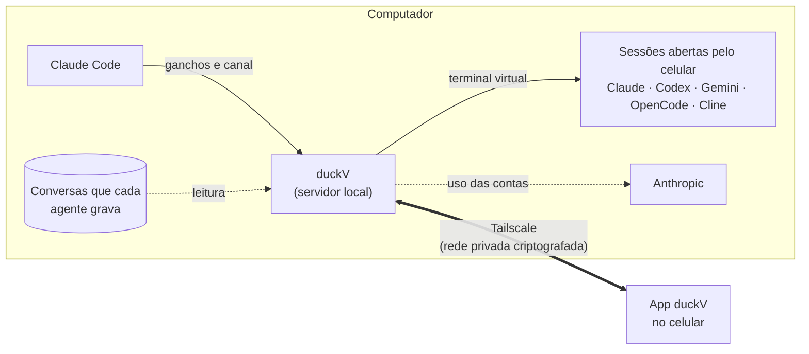

- O **servidor do duckV** (`hub/`) roda no computador e só aceita conexões do próprio computador ou da sua rede do Tailscale.
- Cada conta tem uma **pasta de configuração própria** do Claude Code, com ganchos (`agent/hook.mjs`) e linha de status (`agent/statusline.mjs`) que avisam o duckV do que acontece, e um **canal** (`agent/channel.mjs`) que leva as mensagens do celular para dentro da sessão.
- **Sessões abertas pelo celular** rodam num terminal virtual dentro do duckV, com qualquer agente. As perguntas viram botões porque o duckV lê a tela desse terminal.
- Cada agente tem um **adaptador** (`hub/agentes.mjs`) que diz como abri-lo, o que o celular pode escolher (sempre de listas fechadas, nunca flags livres), como saber quem está logado e como ler as conversas que ele grava: arquivos JSONL no Claude Code, no Codex e no Gemini CLI, arquivos JSON no Cline e um banco SQLite no OpenCode.
- O **uso das contas** do Claude Code vem da mesma consulta que o `/usage` faz; o do Codex, dos limites que ele grava junto das conversas.

## Segurança

O duckV comanda o seu computador, então a segurança foi pensada em camadas:

**Pareamento verificado**
- O QR só abre um pedido. Para liberar o aparelho, você digita na janela do computador os **4 números que aparecem só no celular**. Um código vazado (num print, por exemplo) não basta para entrar.
- O código do QR muda a cada vez que o duckV liga e **depois de cada pareamento**. Outros pedidos feitos com o mesmo código são recusados, e três números errados derrubam todos os pedidos abertos.
- Cada celular recebe uma chave própria. No computador fica só um resumo dela, então nem uma sessão do Claude lendo a pasta `data` consegue se passar pelo seu celular.
- **Desparear este celular** (nas Opções) apaga a chave daquele aparelho. Para desparear todos de uma vez: `node hub/server.mjs --novo-token`.

**Rede**
- Nada fica exposto na internet aberta: o duckV só atende o próprio computador e a sua rede privada do Tailscale.
- Ele só responde a pedidos endereçados ao próprio computador (`localhost`, um IP ou o nome dele no Tailscale). Assim, um site aberto no seu navegador não consegue usar DNS rebinding para conversar com o duckV.

**App do computador**
- A janela entra com uma chave criada a cada abertura e entregue ao servidor pelo canal entre os dois processos: ela nunca vai para o disco, para a linha de comando nem para variáveis de ambiente, e só vale em conexões do próprio computador (pelo Tailscale ela é recusada).
- Só o app pode ver e digitar no terminal de verdade das sessões, responder o pareamento, desconectar celulares e abrir janelas de terminal. Um celular pareado que tente esses pedidos é ignorado, e a saída crua do terminal nunca vai para ele.
- A janela roda isolada (sem Node.js, com sandbox), só navega no próprio duckV e só abre links `https` fora dele, no navegador do sistema. Ela só recebe as permissões de avisos e de área de transferência.

**O que o celular pode fazer**
- Não dá para abrir sessão em modos que pulam as permissões (veja as regras de cada agente em [Agentes](#agentes)), nem mandar comandos com `!` ou comandos de barra fora da lista do agente. No Claude Code valem `/model`, `/effort`, `/compact`, `/clear`, `/login`, `/status`, `/cost`, `/usage`, `/context`, `/help`, `/init`, `/resume`, `/rename` e `/review`, além das skills e comandos personalizados que não liberam o terminal sozinhos.
- O texto digitado na tela do terminal passa pelo mesmo filtro.
- Sessões só abrem dentro da sua pasta pessoal, em pastas que já tiveram sessão no computador, ou nas listadas em `pastasPermitidas` no arquivo `data/config.json`. Exemplo: `"pastasPermitidas": ["D:\\projetos"]`.
- Aceitar um pedido ou responder uma sessão pela notificação exige desbloquear o celular. "Não perguntar de novo" pede um segundo toque.
- Anexos vão só para aparelhos pareados, com até 25 MB cada, para a pasta `data/anexos`. A miniatura volta por uma rota que só aceita nomes no formato que o próprio duckV cria, dentro dessa pasta (nada de `../`), só para aparelhos pareados; imagem comum abre como imagem e qualquer outro arquivo (inclusive SVG e HTML) só baixa, nunca abre como página.
- Sair de uma conta só mexe dentro da pasta daquela conta: os comandos de sair vêm do adaptador do agente (nada digitado no celular entra neles) e os arquivos apagados são conferidos para estarem dentro da pasta.
- Prévias e arquivos do projeto só abrem pelo app Android, nunca como página no navegador, para que um HTML de um projeto clonado não rode com a origem do duckV.
- Mesmo com esses filtros, um celular pareado pode aceitar os pedidos dos agentes e mandar trabalho para eles. Trate o celular pareado como uma chave do seu computador: use bloqueio de tela e desparee aparelhos que você não usa mais.

**Contas**
- O duckV nunca vê suas senhas. O login acontece na página de cada empresa; pelo celular, o duckV só repassa ao agente o código de uso único que a página mostra.
- Cada conta guarda o login na própria pasta (no Codex, o duckV liga o armazenamento em arquivo, para as contas não se misturarem no cofre do Windows). Do Cline, o duckV só confere se o arquivo de credenciais existe; ele não é aberto.
- Manter várias contas pessoais é decisão sua: os termos de cada empresa dizem como os planos podem ser usados. Vale conferir.

## Acesso de qualquer lugar

1. Instale o [Tailscale](https://tailscale.com/download) no computador e no celular e entre com a mesma conta nos dois.
2. Abra o duckV. Ele se publica sozinho, só dentro da sua rede do Tailscale:
   - em **HTTPS**, se os certificados estiverem ligados no painel do Tailscale (DNS › HTTPS Certificates);
   - senão em **HTTP**, que dentro do Tailscale já viaja criptografado de ponta a ponta.

Sem o Tailscale, o duckV só abre no próprio computador, em `http://localhost:8765`.

**Ligou o Tailscale com o duckV já aberto?** Não precisa reiniciar: o duckV confere o Tailscale a cada 20 segundos enquanto ele não aparece (e a cada minuto depois). Quando ele conecta, o duckV se publica na rede, troca o QR e o link de pareamento e avisa no terminal. Na tela **Celulares** do app há também o botão **Procurar o Tailscale agora**. Se o Tailscale cair, o QR volta a apontar para este computador até ele voltar.

## Depois de reiniciar o computador

Basta abrir o atalho **duckV**, ou nada, se você escolheu ligar o duckV junto com o computador.

- O **celular continua pareado**: a chave dele fica salva no computador. O código do QR muda, mas ele só serve para parear um aparelho novo.
- As **contas continuam logadas** e o Tailscale liga sozinho com o sistema.
- As **sessões abertas não sobrevivem** ao reinício. As conversas ficam salvas: reabra pelo app, em **Todas as conversas**.

## Opções

A engrenagem no topo do app abre as Opções:

| Seção | O que tem |
|---|---|
| Aparência neste celular | Tema claro, escuro ou igual ao do celular; pato animado, sem gracinhas ou parado; mostrar ou esconder as ferramentas na conversa. |
| Avisos neste celular | Manter a ligação com o app fechado e liberar da economia de bateria. |
| Contas | Nome, cor, tipo de pato e como cada conta começa uma sessão (modelo, esforço, modo de permissão e pasta). |
| Avisos | Quais avisos chegam e a partir de quanto uso o reinício do limite merece aviso. |
| Mensagens rápidas | Até 12 frases que viram botão acima da caixa de mensagem. |
| Este celular | Desparear. |

A aparência fica guardada em cada celular. O resto fica no computador e vale para todos os celulares pareados.

## O pato

Cada conta tem um pato, e o que ele faz diz como a conta está:

| O pato… | Quer dizer |
|---|---|
| anda de um lado para o outro | a conta está trabalhando |
| pula e grasna com um ponto de exclamação | a conta precisa de você |
| fica parado em pé | esperando sua mensagem |
| dorme, com um z subindo | nenhuma sessão aberta |
| fica cinza e tombado | o limite de 5 horas acabou |
| corre e pula | o limite acabou de reiniciar |

Toque nele para ver uma reação. De vez em quando ele faz uma gracinha por conta própria. Com a opção de reduzir movimento do celular ligada, o pato fica parado e o estado continua escrito ao lado.

## O que os números significam

- **Limite de 5 horas e da semana:** o percentual usado e o horário de reinício. No Claude Code, consultados na Anthropic a cada minuto; no Codex, lidos do que ele grava a cada resposta. Os outros agentes não informam limite. Quando a leitura passa de 5 minutos, o app mostra a idade dela.
- **Tokens em 5 h:** soma feita pelo duckV a partir dos históricos guardados neste computador, incluindo as conversas do Claude desktop de cada conta. Não inclui o que você gastou no claude.ai ou em outro aparelho. O número que vale para o limite é o percentual.
- **Contexto:** quanto da memória da conversa já está ocupado. Perto de cheio, compactar a conversa (em Controles) libera espaço.
- As últimas casas de cada medidor ficam mais quentes acima de 80%.

## Limites conhecidos

- O canal das sessões abertas no computador depende de um recurso em prévia do Claude Code, e organizações Team e Enterprise podem desligá-lo. Uma atualização do Claude Code também pode mudá-lo.
- Nos agentes que não são o Claude Code, as sessões abertas no computador só aparecem depois, em Todas as conversas: não há canal para acompanhá-las ao vivo.
- O estado dos outros agentes (trabalhando, esperando, pedindo você) é deduzido da tela, e uma versão nova de um agente pode mudar a tela.
- As perguntas viram botões porque o duckV lê a tela do terminal. Se uma pergunta não virar botão, abra **Controles › Avançado › Ver a tela do terminal** e responda por lá.
- O modo de permissão não tem escolha direta: o botão passa para o próximo modo, como o Shift+Tab, e o app mostra o que o Claude Code diz estar ativo.
- O texto das perguntas vem do próprio agente, em geral em inglês.
- O computador precisa ficar ligado e acordado.

## Problemas comuns

| O que acontece | O que fazer |
|---|---|
| O app diz "Sem conexão" | Confira se a janela do duckV está aberta e se o Tailscale está ligado no celular. |
| "Esse código não vale mais" | O código muda a cada vez que o duckV liga e depois de cada pareamento. Escaneie o código que está na janela agora. |
| O celular não conecta pelo QR (o Tailscale foi ligado depois do duckV) | Espere até 20 segundos: o duckV percebe o Tailscale sozinho e troca o QR. Ou toque em **Procurar o Tailscale agora**, na tela Celulares, e escaneie o QR novo. |
| O navegador mostra "Este navegador ainda não foi conectado" | Abra o link de pareamento nele (veja [No navegador](#no-navegador-mac-iphone-e-outros-computadores)) e digite no computador os 4 números. |
| Sair da conta diz "Encerre as sessões desta conta" | Uma sessão daquela conta está aberta numa janela de terminal. Feche essa janela e tente de novo. |
| O celular mostra os 4 números e nada acontece | Digite os números na janela do duckV, no computador, e aperte Enter. |
| "A mensagem não chegou" numa sessão aberta no computador | A conta é de uma organização que desliga os canais. Abra a sessão pelo celular. |
| A conta mostra "sem leitura" | Normal até a primeira resposta naquela conta. Gemini CLI, OpenCode e Cline não informam limite. |
| "O agente não está instalado neste computador" | Rode `instalar.cmd` de novo ou instale com `npm install -g` (`@openai/codex`, `@google/gemini-cli`, `opencode-ai` ou `cline`). |
| Não aparece "Abrir sessão" | O terminal virtual não carregou. Rode `instalar.cmd` de novo e veja a mensagem. |
| A sessão aberta pelo celular parece parada | Pode haver uma pergunta que não virou botão. Veja a tela do terminal em Controles › Avançado. |
| "Pasta fora das pastas permitidas" | Inclua a pasta em `pastasPermitidas` (veja [Segurança](#segurança)). |
| "A porta 8765 já está em uso" | O duckV já está aberto em outra janela. |

## Para desenvolvedores

<details>
<summary><b>Estrutura do projeto</b></summary>

```
duckv/
├── hub/            servidor do duckV (HTTP + WebSocket), sessões, histórico, uso das contas
├── agent/          ganchos, linha de status e canal MCP que ligam cada Claude Code ao duckV
│                   (hub/agentes.mjs: o adaptador de cada agente)
├── android/        app nativo (Kotlin + Jetpack Compose, Material 3)
├── app/            versão web (PWA) do app e a interface do app do computador (desktop.*)
├── desktop/        app do computador (Electron): liga o servidor, janela, bandeja e aviso de pedidos
├── lib/            configuração e contas
├── tests/          bateria de testes (unidade, portabilidade, servidor, pareamento, sessões, segurança)
├── tools/          modo demonstração (simular.mjs) e gerador dos ícones (icones.mjs)
├── .github/        testes automáticos no Windows, Linux e macOS a cada envio
├── setup.mjs       instalação: pastas das contas, ganchos, canal, atalhos e login
├── instalar.cmd    instalador (Windows)        instalar.sh      instalador (Linux e macOS)
├── iniciar-duckv.cmd                           iniciar-duckv.sh
└── abrir-web.cmd   duckV no navegador          abrir-web.sh     (no Mac, é o que o duckV.command abre)
```

</details>

<details>
<summary><b>Testes</b></summary>

```bash
npm test
```

Roda todas as baterias, uma depois da outra, e mostra o resumo (`node tests/rodar.mjs seguranca` roda só uma). Usam pastas temporárias e portas próprias e não tocam nas suas contas. No Windows, `testar.cmd`; no Linux e no macOS, `sh testar.sh`.

| Bateria | O que confere |
|---|---|
| `unidade` | Filtro do que o celular digita, nomes aceitos no cabeçalho `Host`, caminhos das prévias (com fuzzing de milhares de entradas) e expressões regulares contra texto hostil (ReDoS) |
| `portabilidade` | Scripts de cada sistema, atalhos e "ligar com o computador" (com caminhos com espaço, aspas e `$`), terminal embutido |
| `servidor` | Servidor, canal MCP com um cliente real, permissões e histórico |
| `pareamento` | Pareamento com os 4 números confirmados no computador |
| `sessoes` | Sessões abertas pelo celular, com um terminal de mentira no lugar do agente, e argumentos que tentam injetar comandos no `cmd.exe` |
| `desktop` | App do computador: a chave que só vale no próprio computador, pedidos que só o app pode fazer, terminal de verdade e arquivos de `node_modules` que não podem sair pelo servidor |
| `seguranca` | Ataques de verdade contra um duckV ligado: DNS rebinding, WebSocket sequestrado por outro site, CSRF, segredo dos agentes, travessia de pastas (inclusive `::$DATA`, `CON` e UNC do Windows), limites de tamanho, vazamento de segredos e força bruta no pareamento |

A cada envio ao GitHub, a bateria roda no Windows, no Linux e no macOS, com Node.js 22 e 24, junto com a auditoria das dependências (`npm audit`), a busca de segredos no histórico (gitleaks), a análise estática do CodeQL e a compilação do app Android.

</details>

<details>
<summary><b>Modo demonstração</b></summary>

```bash
node tools/simular.mjs
```

Liga um duckV separado (porta 8766) com três contas, sessões e pedidos de mentira, para ver o app sem conectar o Claude Code de verdade. No Windows, `demonstracao.cmd`; no Linux e no macOS, `sh demonstracao.sh`.

</details>

<details>
<summary><b>App do computador</b></summary>

```bash
cd desktop
npm install
npm start                 # abre o app (DUCKV_DEMO=1 abre com as contas de mentira)
npm run dist:win          # no Windows: instalador e versão portátil em desktop/dist
npm run dist:linux        # no Linux: AppImage e .deb em desktop/dist
```

O executável não traz o servidor dentro dele: ele acha a pasta do duckV pelo arquivo `~/.duckv/instalacao.json`, que o instalador grava (ou pela variável `DUCKV_PASTA`), e usa o Node.js do computador.

</details>

<details>
<summary><b>Compilar o app Android</b></summary>

```bash
cd android
gradlew assembleRelease
```

Precisa do Android SDK. A assinatura fica em `android/assinatura.properties`, fora do repositório. O APK sai em `android/app/build/outputs/apk/release/`.

</details>

<details>
<summary><b>Personalizar contas à mão</b></summary>

Nomes, cores e padrões mudam pelas Opções do app. Para acrescentar ou tirar contas fora do app, edite `contas.json` (cores em hexadecimal), rode o instalador de novo e reinicie o duckV.

</details>

## Desinstalar

Rode **`desinstalar.cmd`** (Windows) ou `sh desinstalar.sh` (Linux e macOS). Ele retira das pastas de conta o que a instalação configurou e apaga os atalhos do duckV, inclusive o de ligar com o computador. Os logins e os históricos ficam em `.claude-contas` e `.duckv-contas`, na sua pasta pessoal; apague essas pastas e a do duckV se não quiser mais nada.

## Créditos

Fontes Bricolage Grotesque, Pixelify Sans e JetBrains Mono (SIL Open Font License). Ícones Material Icons (Apache 2.0) no app Android e Phosphor (MIT) na versão web. O pato foi desenhado para este app.
