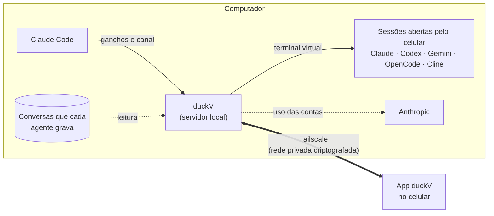

<div align="center">

<picture>
  <source media="(prefers-color-scheme: dark)" srcset="docs/imagens/logo-escuro.svg">
  
</picture>

**Acompanhe e comande, pelo celular, seus agentes de código: Claude Code, Codex, Gemini CLI, OpenCode e Cline.**

[](https://github.com/victor-kauan-coder/duckv/releases/latest)


[Começar](#começar-em-3-passos) · [Telas](#telas) · [Como funciona](#como-funciona) · [Segurança](#segurança) · [Problemas comuns](#problemas-comuns)


</div>

---

O **duckV** junta num app só os agentes de código que rodam no seu computador, com quantas contas você quiser de cada um: [Claude Code](https://claude.com/claude-code), [Codex](https://github.com/openai/codex), [Gemini CLI](https://github.com/google-gemini/gemini-cli), [OpenCode](https://opencode.ai) e [Cline](https://cline.bot). Do celular você vê o que cada sessão está fazendo, quanto do limite já gastou, responde pedidos de permissão, conversa, anexa arquivos e abre sessões novas no computador, sem trocar de login e sem estar na frente da máquina.

> [!NOTE]
> Ferramenta pessoal e **não oficial**, sem ligação com Anthropic, OpenAI, Google, OpenCode ou Cline. Os nomes dos agentes são marcas dos seus donos; os ícones em pixels do app são desenhos próprios.

## Sumário

- [Destaques](#destaques)
- [Agentes](#agentes)
- [Começar em 3 passos](#começar-em-3-passos)
- [O que você precisa](#o-que-você-precisa)
- [Telas](#telas)
- [Uso no dia a dia](#uso-no-dia-a-dia)
- [Contas](#contas)
- [Como funciona](#como-funciona)
- [Segurança](#segurança)
- [Acesso de qualquer lugar](#acesso-de-qualquer-lugar)
- [Depois de reiniciar o computador](#depois-de-reiniciar-o-computador)
- [Opções](#opções)
- [O pato](#o-pato)
- [O que os números significam](#o-que-os-números-significam)
- [Limites conhecidos](#limites-conhecidos)
- [Problemas comuns](#problemas-comuns)
- [Para desenvolvedores](#para-desenvolvedores)
- [Desinstalar](#desinstalar)

## Destaques

| | |
|---|---|
| **Vários agentes, várias contas** | Claude Code, Codex, Gemini CLI, OpenCode e Cline lado a lado. Cada conta mostra o ícone e o nome do agente, em todas as telas. |
| **Todas as contas num lugar** | Uma tela por conta, com o limite de 5 horas e o da semana em tempo real (Claude Code e Codex). |
| **Conversa completa** | Mensagens, tabelas, blocos de código, imagens, lista de tarefas e as ferramentas que o agente usa. |
| **Contexto à vista** | Um anel ao lado da caixa de mensagem mostra quanto da memória da conversa já foi usado, com o detalhe a um toque. |
| **Permissões no bolso** | Aceite, recuse ou recuse dizendo o que fazer no lugar. Direto na notificação, mesmo com o app fechado. |
| **Abrir sessões pelo celular** | Escolha conta, pasta, modelo, esforço e modo de permissão; a sessão roda no computador e você comanda pelo app. |
| **Conversas do Claude desktop** | Todas as conversas de cada conta, inclusive as feitas no app Claude desktop, para acompanhar ou continuar. |
| **Anexos** | Mande arquivos do celular para o agente ler. |
| **Mensagens de voz** | Toque no microfone e fale: o celular transcreve ao vivo, você revisa ou envia direto, e a mensagem aparece com o selo de voz. |
| **Pareamento verificado** | O QR sozinho não dá acesso: os 4 números do celular precisam ser digitados no computador. |
| **Instalação em um clique** | O instalador cuida do que faltar e faz o login das contas. |
| **Um pato por conta** | Ele mostra, em pixels, se a conta trabalha, espera, dorme ou precisa de você. |

## Agentes

Cada conta do duckV usa um agente. Você escolhe o agente ao adicionar a conta, e o app mostra o ícone dele no seletor de contas, no cartão da conta, na tela de abrir sessão e no topo de cada conversa.

<div align="center">

</div>

| | Claude Code | Codex | Gemini CLI | OpenCode | Cline |
|---|:---:|:---:|:---:|:---:|:---:|
| Abrir sessão pelo celular | ✓ | ✓ | ✓ | ✓ | ✓ |
| Conversa e tokens no app | ✓ | ✓ | ✓ | ✓ ¹ | ✓ |
| Perguntas e permissões como botões | ✓ | ✓ | ✓ | pela tela do terminal | ✓ |
| Entrar na conta pelo celular | ✓ | ✓ | ✓ | ✓ | ✓ |
| Limite de 5 horas e da semana | ✓ | ✓ | — | — | — |
| Conversas antigas e continuar | ✓ | ✓ | ✓ | ✓ | ✓ |
| Sessão aberta no computador, ao vivo | ✓ ² | — | — | — | — |

¹ Precisa do Node.js 22.13 ou mais novo no computador (o OpenCode guarda as conversas num banco SQLite).
² Pelo canal do Claude Code. Nos outros agentes, as sessões abertas no computador aparecem depois em **Todas as conversas**, e dá para continuá-las pelo celular.

**Como entrar em cada agente pelo celular:** toque em **Entrar nesta conta**. O Claude Code abre a página da Anthropic e pede o código que ela mostra no fim. Os outros abrem a própria tela de login do agente: os links viram botões que abrem no navegador do celular, os menus viram botões e há um campo para colar códigos. O Codex mostra um código de dispositivo; o Gemini CLI, um link do Google e um campo para o código; o OpenCode e o Cline, a lista de provedores (o OpenCode funciona até sem login, com os modelos gratuitos dele).

**O que o duckV garante em cada agente**, sempre, nas sessões abertas pelo celular:

| Agente | Regra aplicada |
|---|---|
| Claude Code | Sem o modo que pula todas as permissões. |
| Codex | Sempre pede aprovação (`-a on-request`) e roda em sandbox: edita só a pasta do projeto ou só lê. Nunca o modo sem sandbox. |
| Gemini CLI | Sem o modo `yolo`: pergunta sempre, aceita só edições ou só planeja. |
| OpenCode | Tudo pede permissão, exceto ler; nada fora da pasta do projeto; compartilhar conversas na internet desligado. |
| Cline | A aprovação automática, que vem ligada por padrão no Cline, é sempre desligada. |

Os comandos de barra que mudam permissões (`/permissions`, `/approvals`, `/yolo`, `/share`…) e os comandos com `!` não passam pelo celular; cada agente tem a sua lista de comandos liberados.

## Começar em 3 passos

**1. No computador (Windows).** Baixe esta pasta (botão **Code › Download ZIP**, ou `git clone`), dê dois cliques em **`instalar.cmd`** e responda as perguntas com S ou N. O instalador:

- instala o que faltar: Node.js, Claude Code e, se você quiser, o Tailscale;
- prepara uma pasta separada para cada conta e liga cada uma ao duckV;
- abre o navegador para você entrar em cada conta Claude;
- cria o atalho **duckV** na área de trabalho e, se você quiser, faz ele ligar junto com o Windows;
- liga o duckV.

**2. No celular (Android).** Instale o **`duckV.apk`** da [página de versões](https://github.com/victor-kauan-coder/duckv/releases/latest) (o Android pede para permitir "instalar apps desconhecidos"). Para usar fora de casa, instale também o app **Tailscale** e entre com a mesma conta do computador. No duckV, toque em **Escanear código** e aponte para o código da janela do duckV.

**3. Confirme no computador.** O celular mostra 4 números. Digite-os na janela do duckV e aperte Enter. Pronto.

<div align="center">

&nbsp;&nbsp;

</div>

> [!TIP]
> Pulou o login de alguma conta? Entre depois pelo próprio celular: o cartão da conta mostra **Entrar nesta conta**.

## O que você precisa

| Onde | O quê |
|---|---|
| Computador | Windows 10 ou 11. O instalador usa o **winget**, que já vem no Windows, para instalar o que faltar. |
| Celular | Android 8 ou mais novo. |
| Contas | Uma ou mais contas de cada agente que for usar. O Claude Code e o Codex usam a assinatura (Pro, Max, Team ou Plus); o Gemini CLI, uma conta Google; o OpenCode funciona até sem conta. |
| Fora de casa | [Tailscale](https://tailscale.com/download) no computador e no celular, na mesma conta. Gratuito para uso pessoal. |

A instalação não mexe nos seus agentes de sempre: as contas do duckV vivem em pastas próprias (`C:\Users\voce\.claude-contas\` para o Claude Code e `C:\Users\voce\.duckv-contas\` para os outros). Seus logins atuais, o app Claude desktop e as configurações de cada agente continuam como estão.

<details>
<summary><b>Instalação manual</b></summary>

1. Instale o [Node.js](https://nodejs.org) 20 ou mais novo e o Claude Code (`npm install -g @anthropic-ai/claude-code`).
2. Rode `instalar.cmd` (ou `npm install` e `node setup.mjs`).
3. Entre em cada conta: `conta1.cmd` e `/login`, ou `claude auth login` com `CLAUDE_CONFIG_DIR` apontando para a pasta da conta.
4. Abra `iniciar-duckv.cmd` (ou `npm start`).

</details>

## Telas

<table>
<tr>
<td align="center" width="33%"><br><b>Início</b><br><sub>Limite de 5 horas em destaque, semana, tokens e as sessões da conta.</sub></td>
<td align="center" width="33%"><br><b>Contas e agentes</b><br><sub>Cada conta com o ícone do seu agente. O ponto vermelho avisa quem precisa de você.</sub></td>
<td align="center" width="33%"><br><b>Permissões</b><br><sub>O comando inteiro, com aceitar, recusar ou recusar dizendo o que fazer.</sub></td>
</tr>
<tr>
<td align="center"><br><b>Conversa</b><br><sub>Contexto, tarefas, código, mensagens rápidas, anexos e o anel de contexto.</sub></td>
<td align="center"><br><b>Abrir sessão</b><br><sub>Conta, o agente que vai abrir, pasta do projeto e nome.</sub></td>
<td align="center"><br><b>Modelo e esforço</b><br><sub>As opções de cada agente (aqui, o Codex).</sub></td>
</tr>
<tr>
<td align="center"><br><b>Controles</b><br><sub>Modelo, esforço, modo de permissão, interromper, compactar e encerrar.</sub></td>
<td align="center"><br><b>Opções</b><br><sub>Tema, pato, avisos, contas e mensagens rápidas.</sub></td>
<td align="center"><br><b>Tema escuro</b><br><sub>Segue o celular, ou escolha nas Opções.</sub></td>
</tr>
</table>

<sub>Capturas feitas no modo demonstração: contas, sessões e números de mentira.</sub>

## Uso no dia a dia

### Abrir uma sessão pelo celular

Toque em **Abrir sessão**, escolha a conta (o selo mostra qual agente vai abrir), a pasta do projeto, o modelo, o esforço e o modo de permissão. As opções são as do agente daquela conta. A sessão roda no computador, dentro do duckV, e você comanda tudo pelo app:

- **Conversa:** escreva, toque numa mensagem rápida ou anexe arquivos pelo clipe. Comandos também valem, como `/model opus` ou `/compact`.
- **Perguntas do agente** (incluindo "você confia nesta pasta?") aparecem como botões, e dá para escrever uma resposta própria quando a pergunta permite.
- **Controles:** interromper, compactar, limpar e encerrar. No Claude Code, também trocar modelo, esforço e modo no meio da sessão.
- **Tela do terminal:** a tela crua do agente, com setas, Enter, Esc, os links tocáveis e um campo para digitar. Serve para o que não virar botão.

### Abrir uma sessão no computador

Abra o atalho da conta (`conta1.cmd`, `conta2.cmd`…) e informe a pasta do projeto, ou arraste a pasta para cima do atalho. O atalho abre o agente da conta, com a pasta dela e as mesmas regras de segurança. No Claude Code aparece um aviso sobre "development channels": escolha **I am using this for local development**. O aviso aparece toda vez, porque o canal do duckV usa um recurso do Claude Code que ainda está em prévia.

Pelo celular você acompanha a sessão, conversa e responde permissões.

> [!WARNING]
> Organizações **Team** e **Enterprise** podem desligar esse canal. Nesse caso o Claude Code ignora as mensagens do celular, e o app avisa em até 30 segundos. Para conversar pelo celular com essas contas, abra a sessão **pelo celular**, que funciona em qualquer plano.

### Conversas antigas

Em **Todas as conversas** ficam todas as conversas de cada conta, com o título que o agente deu. Nas contas do Claude Code entram também as feitas no app **Claude desktop**, separadas pela conta de cada uma. Toque numa conversa para ler o histórico inteiro e continue de onde parou com **Continuar pelo celular**, sempre com o login da conta certa (feche a conversa no desktop antes, para as duas não escreverem juntas).

### Anexos e imagens

O clipe ao lado da caixa de mensagem envia arquivos do celular (até 10 por vez, com até 25 MB cada). Eles ficam numa pasta do duckV no computador, e a mensagem leva o caminho para o agente ler. Imagens da conversa (as que você colou, as que o agente abriu ou gerou) aparecem no chat e abrem em tela cheia.

### Pedidos de permissão

Aparecem no topo da conta e como notificação, com o comando inteiro e três saídas: **aceitar**, **recusar** ou **recusar dizendo ao agente o que fazer no lugar**. Nas sessões abertas no computador, o pedido aparece também na janela, e vale a primeira resposta.

## Contas

- **Adicionar uma conta:** no seletor de contas, toque em **Adicionar conta** e escolha o agente. O duckV cria a pasta, o atalho (e o canal, no Claude Code) e já abre a entrada na conta pelo celular.
- **Entrar numa conta pelo celular:** toque em **Entrar nesta conta** (veja [Agentes](#agentes)). O duckV nunca vê sua senha.
- **Agente não instalado:** o cartão da conta avisa. Rode o instalador de novo ou instale com `npm install -g` o pacote do agente.
- **Nome, cor e pato:** nas Opções, em Contas. Contas sem nome próprio aparecem com o começo do e-mail.

## Como funciona



- O **servidor do duckV** (`hub/`) roda no computador e só aceita conexões do próprio computador ou da sua rede do Tailscale.
- Cada conta tem uma **pasta de configuração própria** do Claude Code, com ganchos (`agent/hook.mjs`) e linha de status (`agent/statusline.mjs`) que avisam o duckV do que acontece, e um **canal** (`agent/channel.mjs`) que leva as mensagens do celular para dentro da sessão.
- **Sessões abertas pelo celular** rodam num terminal virtual dentro do duckV, com qualquer agente. As perguntas viram botões porque o duckV lê a tela desse terminal.
- Cada agente tem um **adaptador** (`hub/agentes.mjs`) que diz como abri-lo, o que o celular pode escolher (sempre de listas fechadas, nunca flags livres), como saber quem está logado e como ler as conversas que ele grava: arquivos JSONL no Claude Code, no Codex e no Gemini CLI, arquivos JSON no Cline e um banco SQLite no OpenCode.
- O **uso das contas** do Claude Code vem da mesma consulta que o `/usage` faz; o do Codex, dos limites que ele grava junto das conversas.

## Segurança

O duckV comanda o seu computador, então a segurança foi pensada em camadas:

**Pareamento verificado**
- O QR só abre um pedido. Para liberar o aparelho, você digita na janela do computador os **4 números que aparecem só no celular**. Um código vazado (num print, por exemplo) não basta para entrar.
- O código do QR muda a cada vez que o duckV liga e **depois de cada pareamento**. Outros pedidos feitos com o mesmo código são recusados, e três números errados derrubam todos os pedidos abertos.
- Cada celular recebe uma chave própria. No computador fica só um resumo dela, então nem uma sessão do Claude lendo a pasta `data` consegue se passar pelo seu celular.
- **Desparear este celular** (nas Opções) apaga a chave daquele aparelho. Para desparear todos de uma vez: `node hub/server.mjs --novo-token`.

**Rede**
- Nada fica exposto na internet aberta: o duckV só atende o próprio computador e a sua rede privada do Tailscale.

**O que o celular pode fazer**
- Não dá para abrir sessão em modos que pulam as permissões (veja as regras de cada agente em [Agentes](#agentes)), nem mandar comandos com `!` ou comandos de barra fora da lista do agente. No Claude Code valem `/model`, `/effort`, `/compact`, `/clear`, `/login`, `/status`, `/cost`, `/usage`, `/context`, `/help`, `/init`, `/resume`, `/rename` e `/review`.
- O texto digitado na tela do terminal passa pelo mesmo filtro.
- Sessões só abrem dentro da sua pasta pessoal, em pastas que já tiveram sessão no computador, ou nas listadas em `pastasPermitidas` no arquivo `data/config.json`. Exemplo: `"pastasPermitidas": ["D:\\projetos"]`.
- Aceitar um pedido pela notificação exige desbloquear o celular. "Não perguntar de novo" pede um segundo toque.
- Anexos vão só para celulares pareados, com até 25 MB cada, para a pasta `data/anexos`.

**Contas**
- O duckV nunca vê suas senhas. O login acontece na página de cada empresa; pelo celular, o duckV só repassa ao agente o código de uso único que a página mostra.
- Cada conta guarda o login na própria pasta (no Codex, o duckV liga o armazenamento em arquivo, para as contas não se misturarem no cofre do Windows). Do Cline, o duckV só confere se o arquivo de credenciais existe; ele não é aberto.
- Manter várias contas pessoais é decisão sua: os termos de cada empresa dizem como os planos podem ser usados. Vale conferir.

## Acesso de qualquer lugar

1. Instale o [Tailscale](https://tailscale.com/download) no computador e no celular e entre com a mesma conta nos dois.
2. Abra o duckV. Ele se publica sozinho, só dentro da sua rede do Tailscale:
   - em **HTTPS**, se os certificados estiverem ligados no painel do Tailscale (DNS › HTTPS Certificates);
   - senão em **HTTP**, que dentro do Tailscale já viaja criptografado de ponta a ponta.

Sem o Tailscale, o duckV só abre no próprio computador, em `http://localhost:8765`.

## Depois de reiniciar o computador

Basta abrir o atalho **duckV** na área de trabalho, ou nada, se você escolheu ligar o duckV junto com o Windows.

- O **celular continua pareado**: a chave dele fica salva no computador. O código do QR muda, mas ele só serve para parear um aparelho novo.
- As **contas continuam logadas** e o Tailscale liga sozinho com o Windows.
- As **sessões abertas não sobrevivem** ao reinício. As conversas ficam salvas: reabra pelo app, em **Todas as conversas**.

## Opções

A engrenagem no topo do app abre as Opções:

| Seção | O que tem |
|---|---|
| Aparência neste celular | Tema claro, escuro ou igual ao do celular; pato animado, sem gracinhas ou parado; mostrar ou esconder as ferramentas na conversa. |
| Avisos neste celular | Manter a ligação com o app fechado e liberar da economia de bateria. |
| Contas | Nome, cor, tipo de pato e como cada conta começa uma sessão (modelo, esforço, modo de permissão e pasta). |
| Avisos | Quais avisos chegam e a partir de quanto uso o reinício do limite merece aviso. |
| Mensagens rápidas | Até 12 frases que viram botão acima da caixa de mensagem. |
| Este celular | Desparear. |

A aparência fica guardada em cada celular. O resto fica no computador e vale para todos os celulares pareados.

## O pato

Cada conta tem um pato, e o que ele faz diz como a conta está:

| O pato… | Quer dizer |
|---|---|
| anda de um lado para o outro | a conta está trabalhando |
| pula e grasna com um ponto de exclamação | a conta precisa de você |
| fica parado em pé | esperando sua mensagem |
| dorme, com um z subindo | nenhuma sessão aberta |
| fica cinza e tombado | o limite de 5 horas acabou |
| corre e pula | o limite acabou de reiniciar |

Toque nele para ver uma reação. De vez em quando ele faz uma gracinha por conta própria. Com a opção de reduzir movimento do celular ligada, o pato fica parado e o estado continua escrito ao lado.

## O que os números significam

- **Limite de 5 horas e da semana:** o percentual usado e o horário de reinício. No Claude Code, consultados na Anthropic a cada minuto; no Codex, lidos do que ele grava a cada resposta. Os outros agentes não informam limite. Quando a leitura passa de 5 minutos, o app mostra a idade dela.
- **Tokens em 5 h:** soma feita pelo duckV a partir dos históricos guardados neste computador, incluindo as conversas do Claude desktop de cada conta. Não inclui o que você gastou no claude.ai ou em outro aparelho. O número que vale para o limite é o percentual.
- **Contexto:** quanto da memória da conversa já está ocupado. Perto de cheio, compactar a conversa (em Controles) libera espaço.
- As últimas casas de cada medidor ficam mais quentes acima de 80%.

## Limites conhecidos

- O canal das sessões abertas no computador depende de um recurso em prévia do Claude Code, e organizações Team e Enterprise podem desligá-lo. Uma atualização do Claude Code também pode mudá-lo.
- Nos agentes que não são o Claude Code, as sessões abertas no computador só aparecem depois, em Todas as conversas: não há canal para acompanhá-las ao vivo.
- O estado dos outros agentes (trabalhando, esperando, pedindo você) é deduzido da tela, e uma versão nova de um agente pode mudar a tela.
- As perguntas viram botões porque o duckV lê a tela do terminal. Se uma pergunta não virar botão, abra **Controles › Avançado › Ver a tela do terminal** e responda por lá.
- O modo de permissão não tem escolha direta: o botão passa para o próximo modo, como o Shift+Tab, e o app mostra o que o Claude Code diz estar ativo.
- O texto das perguntas vem do próprio agente, em geral em inglês.
- O computador precisa ficar ligado e acordado.

## Problemas comuns

| O que acontece | O que fazer |
|---|---|
| O app diz "Sem conexão" | Confira se a janela do duckV está aberta e se o Tailscale está ligado no celular. |
| "Esse código não vale mais" | O código muda a cada vez que o duckV liga e depois de cada pareamento. Escaneie o código que está na janela agora. |
| O celular mostra os 4 números e nada acontece | Digite os números na janela do duckV, no computador, e aperte Enter. |
| "A mensagem não chegou" numa sessão aberta no computador | A conta é de uma organização que desliga os canais. Abra a sessão pelo celular. |
| A conta mostra "sem leitura" | Normal até a primeira resposta naquela conta. Gemini CLI, OpenCode e Cline não informam limite. |
| "O agente não está instalado neste computador" | Rode `instalar.cmd` de novo ou instale com `npm install -g` (`@openai/codex`, `@google/gemini-cli`, `opencode-ai` ou `cline`). |
| Não aparece "Abrir sessão" | O terminal virtual não carregou. Rode `instalar.cmd` de novo e veja a mensagem. |
| A sessão aberta pelo celular parece parada | Pode haver uma pergunta que não virou botão. Veja a tela do terminal em Controles › Avançado. |
| "Pasta fora das pastas permitidas" | Inclua a pasta em `pastasPermitidas` (veja [Segurança](#segurança)). |
| "A porta 8765 já está em uso" | O duckV já está aberto em outra janela. |

## Para desenvolvedores

<details>
<summary><b>Estrutura do projeto</b></summary>

```
duckv/
├── hub/            servidor do duckV (HTTP + WebSocket), sessões, histórico, uso das contas
├── agent/          ganchos, linha de status e canal MCP que ligam cada Claude Code ao duckV
│                   (hub/agentes.mjs: o adaptador de cada agente)
├── android/        app nativo (Kotlin + Jetpack Compose, Material 3)
├── app/            versão web (PWA) do app
├── lib/            configuração e contas
├── tests/          testes de ponta a ponta (servidor, pareamento, sessões)
├── tools/          modo demonstração
├── setup.mjs       instalação: pastas das contas, ganchos, canal, atalhos e login
├── instalar.cmd    instalador em um clique (Windows)
└── iniciar-duckv.cmd
```

</details>

<details>
<summary><b>Testes</b></summary>

```bash
npm test
```

Testam o servidor, o canal (com um cliente real do protocolo MCP), o pareamento com confirmação e as sessões abertas pelo celular (com um terminal de mentira no lugar do Claude Code). Usam pastas temporárias e não tocam nas suas contas. No Windows, `testar.cmd` faz o mesmo.

</details>

<details>
<summary><b>Modo demonstração</b></summary>

```bash
node tools/simular.mjs
```

Liga um duckV separado (porta 8766) com três contas, sessões e pedidos de mentira, para ver o app sem conectar o Claude Code de verdade. No Windows, `demonstracao.cmd`.

</details>

<details>
<summary><b>Compilar o app Android</b></summary>

```bash
cd android
gradlew assembleRelease
```

Precisa do Android SDK. A assinatura fica em `android/assinatura.properties`, fora do repositório. O APK sai em `android/app/build/outputs/apk/release/`.

</details>

<details>
<summary><b>Personalizar contas à mão</b></summary>

Nomes, cores e padrões mudam pelas Opções do app. Para acrescentar ou tirar contas fora do app, edite `contas.json` (cores em hexadecimal), rode `instalar.cmd` de novo e reinicie o duckV.

</details>

## Desinstalar

Rode **`desinstalar.cmd`**. Ele retira das pastas de conta o que a instalação configurou e apaga os atalhos do duckV. Os logins e os históricos ficam em `C:\Users\voce\.claude-contas\`; apague essa pasta e a do duckV se não quiser mais nada.

## Créditos

Fontes Bricolage Grotesque, Pixelify Sans e JetBrains Mono (SIL Open Font License). Ícones Material Icons (Apache 2.0) no app Android e Phosphor (MIT) na versão web. O pato foi desenhado para este app.
